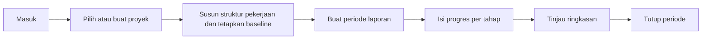
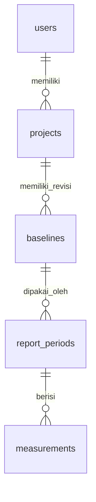
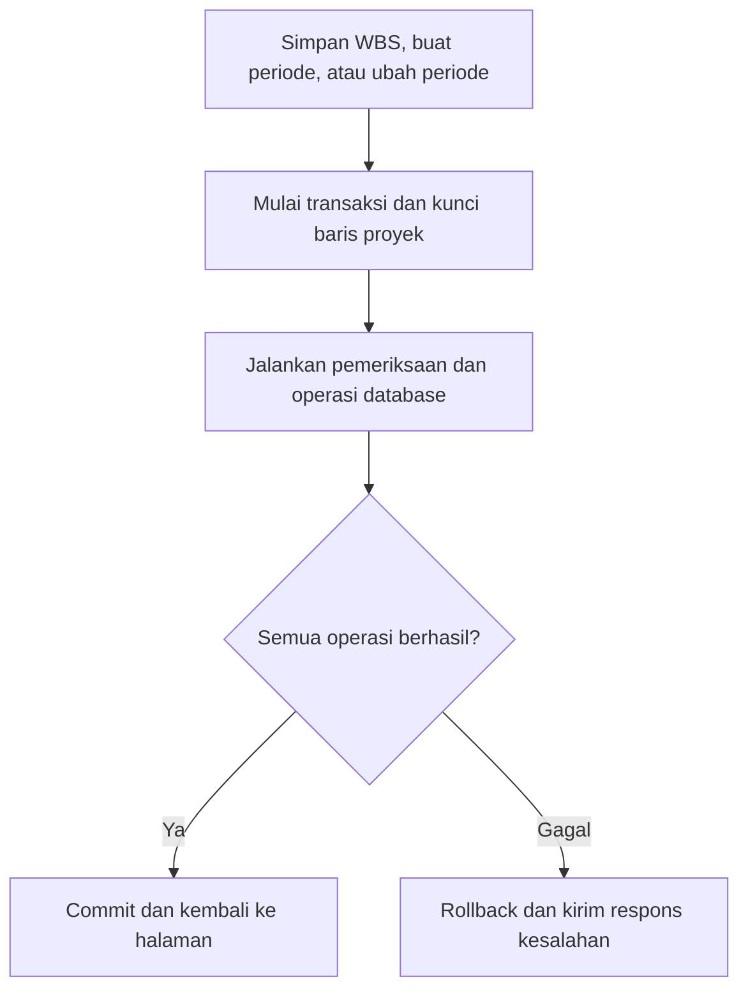

# Alur UI dan Backend SiMonitoringGalangan

SiMonitoringGalangan mencatat progres fisik pembangunan kapal per periode laporan. Pengguna menyusun struktur pekerjaan, menetapkannya sebagai baseline, lalu mengisi realisasi untuk dibandingkan dengan target.

## Alur UI

1. **Masuk dan pilih proyek.** Setelah login dan verifikasi email, buka dashboard. Pilih proyek dari daftar **Proyek kapal** di bagian atas. Jika belum ada proyek, dashboard menampilkan formulir pembuatan proyek.
2. **Buat proyek.** Klik **+ Buat proyek**. Isi kode pembangunan, nama kapal, galangan, serta tanggal mulai dan selesai. Pilih **Mulai dari struktur kosong** atau salin struktur dari proyek sendiri. Setelah disimpan, aplikasi membuka **Form Builder**.
3. **Susun struktur pekerjaan di Form Builder.** Bagi pekerjaan menjadi kelompok dan item. Setiap kelompok punya tahapan pengukuran yang dipakai oleh item di dalamnya. Klik **Simpan draft** untuk melanjutkan penyusunan nanti. Klik **Tetapkan baseline** untuk membuat revisi yang bisa dipakai dalam laporan. Total bobot semua item proyek harus 100%, dan total bobot tahap di setiap kelompok juga harus 100%.
4. **Buat periode di Input Progres.** Isi tanggal mulai dan akhir, serta target kumulatif jika tersedia. Proyek harus sudah memiliki baseline, dan tanggal periode baru tidak boleh bertumpang tindih dengan periode lain di proyek yang sama.
5. **Isi realisasi.** Pada periode terbuka, pilih kelompok dan item, isi realisasi setiap tahap dari 0 sampai 100%, lalu klik **Simpan progres**. Kolom kosong berarti tahap belum diukur. Angka 0% berarti tahap sudah dicatat dengan realisasi nol.
6. **Tinjau dan tutup periode.** Buka **Ringkasan** untuk melihat realisasi fisik, target, deviasi, dan riwayat periode. Buka **Struktur Pekerjaan dan Pengukuran Progres** untuk melihat detail pekerjaan. Saat laporan selesai, kembali ke **Input Progres** dan pilih **Tutup periode**. Realisasi dan target periode itu akan terkunci.

## Alur backend

React mengirim navigasi dan data formulir ke rute Laravel melalui Inertia. Middleware memeriksa sesi login dan verifikasi email. `MonitoringController` membatasi akses ke proyek milik pengguna, memvalidasi data, lalu membaca atau menyimpan data di database. Untuk membuka halaman, Laravel mengirim data ke halaman React lewat Inertia. Setelah penyimpanan, Laravel mengarahkan kembali ke halaman terkait. Pesan validasi ditampilkan di UI jika input bermasalah.

### Relasi tabel

| Tabel | Data yang disimpan |
| --- | --- |
| `projects` | Identitas proyek, pemilik (`user_id`), dan WBS yang masih bisa diedit (`draft`). |
| `baselines` | Salinan WBS saat ditetapkan (`structure`), nomor revisi, dan proyek asal (`project_id`). |
| `report_periods` | Rentang tanggal, target, waktu penutupan (`closed_at`), dan revisi WBS yang dirujuk (`baseline_id`). |
| `measurements` | Nilai realisasi untuk satu kombinasi periode (`period_id`), item, dan tahap. ID item dan tahap merujuk ke struktur JSON baseline. |

### Baca dan tulis data

| Aksi dan rute | Proses Laravel | Operasi database |
| --- | --- | --- |
| Buka Ringkasan atau ganti periode (`GET /dashboard`, `GET /monitoring/{section}`) | `index` | Baca proyek milik pengguna, periode beserta baseline masing-masing, dan hasil pengukuran. Hitung progres serta riwayat, lalu kirim hasil ke UI. |
| Buat proyek (`POST /projects`) | `store` | Bila pengguna memilih salin WBS, baca `projects.draft` dari proyek sumber miliknya. Tambahkan satu baris ke `projects` dengan draft awal. |
| Simpan draft atau tetapkan baseline (`PUT /projects/{project}/structure`) | `structure` | Perbarui `projects.draft`. Jika menetapkan baseline, tambahkan baris ke `baselines` berisi salinan WBS dan nomor revisi berikutnya dalam transaksi yang sama. |
| Buat periode (`POST /projects/{project}/periods`) | `period` | Baca baseline terbaru dan periksa apakah tanggal bertumpang tindih dengan periode lain di proyek tersebut. Jika valid, tambahkan baris ke `report_periods` dengan `baseline_id` yang dipilih. |
| Simpan realisasi (`PATCH /projects/{project}/periods/{period}`) | `update` | Baca periode dan baseline-nya untuk memastikan periode masih terbuka dan item serta tahap sesuai dengan WBS. Tambahkan atau perbarui baris di `measurements` untuk nilai yang dikirim. Jika nilai tahap dikosongkan, hapus catatan tahap tersebut jika ada. |
| Simpan target atau tutup periode (rute `PATCH` yang sama) | `update` | Perbarui `report_periods.target` untuk menyimpan target, atau isi `report_periods.closed_at` untuk menutup periode. Backend menolak perubahan pada periode yang sudah ditutup. |

### Cara transaksi database bekerja

`structure`, `period`, dan `update` memakai `DB::transaction()`. Ketiganya meminta kunci pada baris proyek dengan `lockForUpdate()` agar perubahan pada proyek yang sama diproses bergiliran pada database yang mendukung penguncian baris. Misalnya, saat dua permintaan membuat periode untuk proyek yang sama, permintaan kedua menunggu sebelum memeriksa ulang rentang tanggal. Jika muncul kesalahan di tengah transaksi, perubahan dalam transaksi itu dibatalkan. Pembuatan proyek (`store`) menulis satu baris dengan satu operasi insert.

### Contoh perjalanan data

1. Pengguna menyimpan WBS proyek 12 sebagai revisi 1. Database menambahkan baseline dengan `id = 31` dan `project_id = 12`.
2. Pengguna membuat periode mingguan dengan target 40%. Database membuat periode dengan `id = 72`, `baseline_id = 31`, dan `target = 40`.
3. Pengguna mengisi realisasi tahap **Pengecatan** untuk item **Lambung** sebesar 50%. Database menyimpan `period_id = 72`, ID item, ID tahap, dan `value = 50` di `measurements`.
4. Saat Ringkasan dibuka, backend membaca bobot dari baseline 31 dan nilai dari periode 72. Jika proyek 12 kemudian menerbitkan revisi 2, periode 72 tetap memakai baseline 31.

### Perhitungan Ringkasan

Backend menghitung progres item dengan menjumlahkan hasil perkalian bobot tahap dan realisasinya. Contohnya, tahap berbobot 60% dengan realisasi 50% menyumbang 30 poin persentase ke progres item. Backend lalu mengalikan progres setiap item dengan bobot item dan menjumlahkan hasilnya untuk memperoleh realisasi proyek. Deviasi dihitung dari realisasi proyek dikurangi target periode. Jika sebagian tahap belum diukur, Ringkasan menandai laporan sebagai **Parsial**.

Rumus lengkap, perlakuan nilai kosong, dan contoh hitung manual tersedia di [dokumentasi rumus monitoring](RUMUS.md).

### Lokasi kode

| Bagian | Berkas |
| --- | --- |
| Rute monitoring | [routes/web.php](routes/web.php) |
| Halaman monitoring | [dashboard.tsx](resources/js/pages/dashboard.tsx) |
| Editor WBS | [wbs-editor.tsx](resources/js/components/wbs-editor.tsx) |
| Validasi dan penyimpanan | [MonitoringController.php](app/Http/Controllers/MonitoringController.php) |
| Perhitungan progres | [ProgressReport.php](app/Support/ProgressReport.php) |
| Struktur tabel | [Migrasi monitoring](database/migrations/2026_11_22_211806_create_monitoring_tables.php) |
